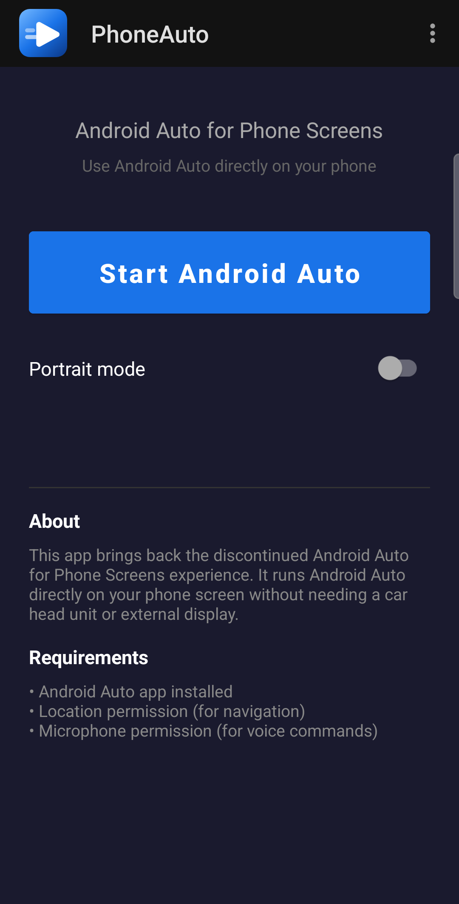
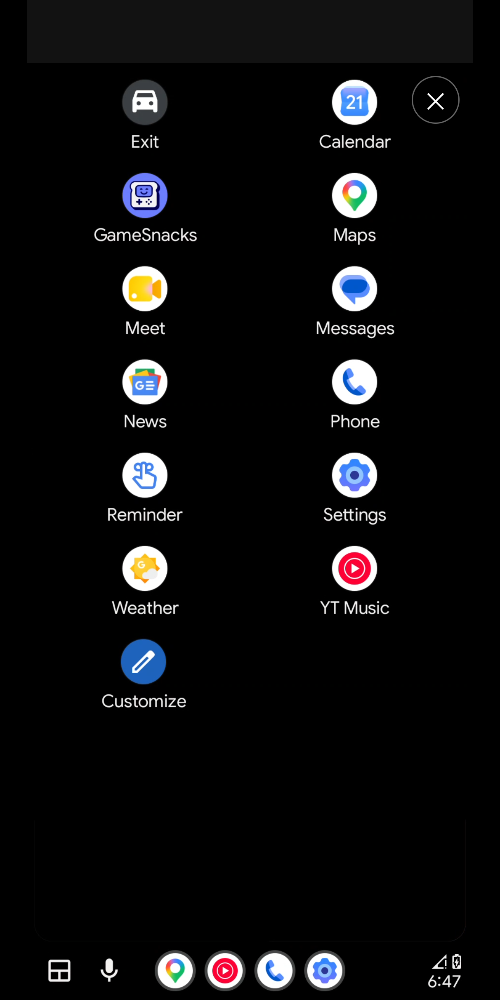
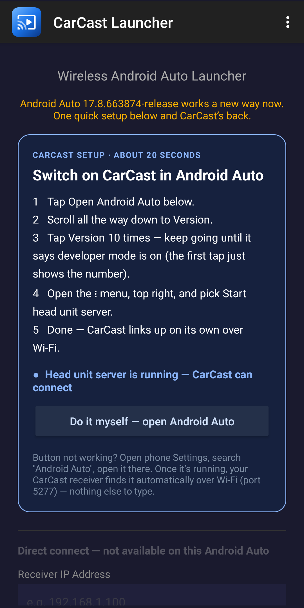

# User guide

PhoneAuto runs Android Auto's car display on your phone's own screen. CarCast Launcher sends your phone's Android Auto to a CarCast receiver over Wi-Fi. Both use Android Auto's built-in **head unit server**, so you need to set that up once.

- [What you need](#what-you-need)
- [Install](#install)
- [One-time setup: Android Auto developer mode](#one-time-setup-android-auto-developer-mode)
- [PhoneAuto](#phoneauto): [start a session](#start-a-session) · [portrait or landscape](#portrait-or-landscape) · [during a session](#during-a-session) · [end a session](#end-a-session)
- [One-tap start (optional)](#one-tap-start-optional)
- [CarCast Launcher](#carcast-launcher)
- [Troubleshooting](#troubleshooting)
- [Updates and expiry](#updates-and-expiry)
- [Privacy](#privacy) · [Reporting a problem](#reporting-a-problem)

## What you need

- An Android phone with Android 7.0 or later. Tested on Pixel phones and a Samsung Galaxy S24 Ultra.
- **Android Auto** from Google Play. Recent phones have it built in.
- For CarCast Launcher: a CarCast receiver (an Android head unit, tablet, iPad or iPhone running [CarCast](https://github.com/rPlayAI/carcast-public)) on the same Wi-Fi.

## Install

1. Download the APK from [Releases](https://github.com/rPlayAI/tarplay-public/releases/latest) on your phone:
   - `PhoneAuto-beta-….apk` for Android Auto on the phone screen;
   - `CarCastLauncher-beta-….apk` for a CarCast receiver.
2. Open the downloaded file. If Android asks, allow installs from your browser or file manager, then tap **Install**.
3. If Google Play Protect warns that the app is unknown, tap **More details › Install anyway**. That warning appears for any app not installed from Google Play.

## One-time setup: Android Auto developer mode

The head unit server is in Android Auto's developer settings, so turn developer mode on once:

1. Open Android Auto settings: **Settings › Connected devices › Android Auto**, or search your phone's Settings for "Android Auto". (On Samsung: **Settings › Connected devices › Android Auto**.)
2. Scroll to **Version** at the very bottom (under *Additional settings* on some phones).
3. Tap **Version** 10 times, until a message says developer mode is on. The first tap only shows the version number; keep tapping. If Android Auto asks to allow development settings, tap **OK**.

Developer mode stays on. You don't need to repeat this unless you clear Android Auto's data.

## PhoneAuto

### Start a session

1. Open **PhoneAuto**.
2. Turn on **Portrait mode** if you want it (see below).
3. Tap **Start Android Auto**.
4. The first time, allow **location** (for navigation), **microphone** (for voice commands) and **nearby devices** (for calls).

If Android Auto's head unit server isn't running yet, PhoneAuto shows **Start the head unit server** with the steps. Tap **Open Android Auto settings**, then tap **⋮** (top right) › **Start head unit server**, and come back. The screen closes by itself once Android Auto connects.

You need to start the head unit server again after the phone restarts or Android Auto updates. To skip that, turn on [one-tap start](#one-tap-start-optional).

### Portrait or landscape

- **Portrait mode on:** Android Auto uses its own tall layout, with the app bar at the bottom. Good for a vertical phone mount.
- **Portrait mode off:** the classic landscape car layout, with the app bar on the left.

The choice applies when a session starts. To switch, [end the session](#end-a-session), change the switch, and start again.

### During a session

PhoneAuto shows exactly what a car would: tap apps in the bar or the app grid, use **Maps**, **Waze**, music apps, **Phone** and **Messages**, and tap the microphone for Google Assistant or Gemini.

- The screen stays on during a session.
- To go back to your phone, press Home. Android Auto keeps running; open PhoneAuto and tap **Return to car** to go back.
- Some apps (such as Weather) answer through the Assistant, which dims the screen for a moment while it replies.

### End a session

Tap **✕** in the top corner. You're back on PhoneAuto's start screen.

## One-tap start (optional)

The APK versions can start Android Auto's head unit server for you, so after a restart you just tap **Start Android Auto**. It uses an accessibility service that only acts when you start a session, and only taps **Start head unit server** in Android Auto's settings. It doesn't read anything else.

1. Do the [one-time developer mode setup](#one-time-setup-android-auto-developer-mode) first.
2. **Android 13 and later, if you installed the APK from a browser or file manager:** open **Settings › Apps › PhoneAuto** (or CarCast Launcher), tap **⋮** (top right) › **Allow restricted settings**, and confirm. If you don't see that option, skip this step.
3. Open **Settings › Accessibility** (on Samsung: **Settings › Accessibility › Installed apps**), tap **PhoneAuto**, and turn it on.

When you tap **Start Android Auto**, PhoneAuto briefly opens Android Auto's settings, taps **Start head unit server**, and comes back. If the server ever gets stuck, PhoneAuto restarts it the same way.

The Google Play versions don't include one-tap start; you start the head unit server by hand.

## CarCast Launcher

1. Put the phone and your CarCast receiver on the **same Wi-Fi**. The phone's hotspot works too: connect the receiver to it.
2. Open **CarCast Launcher**. It shows whether the head unit server is running. If it isn't, follow the steps on screen: **Do it myself — open Android Auto**, then **⋮** › **Start head unit server**.
3. Leave the app. A notification shows CarCast Launcher is running; the receiver finds the phone over Wi-Fi and Android Auto appears on its screen. There's no IP address to type.
4. To stop, tap **Stop** in the notification.

**With iCarCast on an iPad or iPhone:** in iCarCast, turn on Android Auto under **Settings › Modes**, then tap the **Android Auto** button. See [Android Auto in the iCarCast user guide](https://github.com/rPlayAI/carcast-public/blob/main/docs/icarcast-user-guide.md#android-auto).

**Direct connect** (enter the receiver's IP address) only works with older Android Auto versions; on current ones the app shows it as not available.

## Troubleshooting

**"Start head unit server" isn't in the ⋮ menu.**
Developer mode isn't on yet. Tap **Version** in Android Auto settings until it says developer mode is enabled.

**It's stuck on "Waiting for Android Auto" or "connecting".**
In Android Auto settings, tap **⋮** › **Stop head unit server**, then **⋮** › **Start head unit server**, and open PhoneAuto again. With one-tap start on, PhoneAuto does this by itself.

**Maps says "There was an issue loading maps", or Maps is missing from the app list.**
Google Maps needs location permission: **Settings › Apps › Maps › Permissions › Location › Allow only while using the app**. Then end the session and start a new one.

**PhoneAuto says "Permissions required".**
Tap **Start Android Auto** again and allow the permissions, or open **Settings › Apps › PhoneAuto › Permissions** and allow location, microphone and nearby devices.

**Portrait mode shows the landscape layout.**
End the session with **✕**, make sure **Portrait mode** is on, and start again. The choice only applies when a session starts.

**The ⋮ menu or one-tap start doesn't work on my phone.**
Some phones word the menu differently. Start the head unit server by hand and [tell us](#reporting-a-problem) your phone model and language.

**Can't find Android Auto settings.**
Open your phone's Settings app, search for "Android Auto", and open the result.

## Updates and expiry

- The APKs here are **beta builds** and stop working on the date in the file name (for example `PhoneAuto-beta-2027-01-19.apk`). Install a newer one from [Releases](https://github.com/rPlayAI/tarplay-public/releases) before then; it installs over the old one and keeps your settings.
- The Google Play versions don't expire and update through Play.
- APK and Google Play versions are signed differently, so one can't update the other. To switch, uninstall the one you have first.

## Privacy

Nothing leaves your phone. PhoneAuto talks to Android Auto on the same phone (127.0.0.1); CarCast Launcher only talks to devices on your own Wi-Fi. There are no accounts, ads, analytics or tracking. Privacy policies: [PhoneAuto](https://download.youcast.cn/phoneauto-privacy.html) · [CarCast Launcher](https://download.youcast.cn/carcast-privacy.html).

## Reporting a problem

[Open an issue](https://github.com/rPlayAI/tarplay-public/issues/new/choose) with:

- the app and version (PhoneAuto › ⋮ › About);
- your phone model and Android version;
- your Android Auto version (Android Auto settings › Version);
- what you did, what you expected, and what happened. Screenshots help.

---

PhoneAuto and CarCast Launcher are independent apps and are not affiliated with or endorsed by Google. Android Auto is a trademark of Google LLC.
