# User guide

PhoneAuto runs Android Auto's car display on your phone's own screen. CarCast Launcher sends your phone's Android Auto to a CarCast receiver over Wi-Fi. TarPlay Tesla shows your phone's Android Auto in your Tesla's web browser. These three use Android Auto's built-in **head unit server**, so you need to set that up once. TarPlay Receiver works the other way round: it runs on a tablet or head unit and shows a phone's Android Auto there, over Bluetooth and Wi-Fi or USB, with no setup on the phone.

- [What you need](#what-you-need)
- [Install](#install)
- [One-time setup: Android Auto developer mode](#one-time-setup-android-auto-developer-mode)
- [PhoneAuto](#phoneauto): [start a session](#start-a-session) · [portrait or landscape](#portrait-or-landscape) · [icon and text size](#icon-and-text-size) · [during a session](#during-a-session) · [end a session](#end-a-session)
- [One-tap start (optional)](#one-tap-start-optional)
- [CarCast Launcher](#carcast-launcher)
- [TarPlay Tesla](#tarplay-tesla)
- [TarPlay Receiver](#tarplay-receiver): [Bluetooth](#bluetooth-wireless-nothing-to-install-on-the-phone) · [USB](#usb-cable) · [CarCast Launcher](#carcast-launcher-on-the-phone) · [display](#display) · [troubleshooting](#receiver-troubleshooting)
- [Troubleshooting](#troubleshooting)
- [Updates and expiry](#updates-and-expiry)
- [Privacy](#privacy) · [Reporting a problem](#reporting-a-problem)

## What you need

- An Android phone with Android 7.0 or later. Tested on Pixel phones and a Samsung Galaxy S24 Ultra.
- **Android Auto** from Google Play. Recent phones have it built in.
- For CarCast Launcher: a CarCast receiver (an Android head unit, tablet, iPad or iPhone running [CarCast](https://github.com/rPlayAI/carcast-public)) on the same Wi-Fi.
- For TarPlay Tesla: a phone with mobile data and hotspot, and a Tesla with the in-car browser.
- For TarPlay Receiver: an Android tablet or head unit (Android 7.0 or later) with Bluetooth and **5 GHz Wi-Fi**, and a phone with Android 11 or later for wireless Android Auto.

## Install

1. Download the APK from [Releases](https://github.com/rPlayAI/tarplay-public/releases/latest) on your phone:
   - `PhoneAuto-beta-….apk` for Android Auto on the phone screen;
   - `CarCastLauncher-beta-….apk` for a CarCast receiver;
   - `TarPlay-Tesla-beta-….apk` for your Tesla's screen;
   - `TarPlay-Receiver-beta-….apk` on a **tablet or head unit**, to show a phone's Android Auto there.
2. Open the downloaded file. If Android asks, allow installs from your browser or file manager, then tap **Install**.
3. If Google Play Protect warns that the app is unknown, tap **More details › Install anyway**. That warning appears for any app not installed from Google Play.

## One-time setup: Android Auto developer mode

The head unit server is in Android Auto's developer settings, so turn developer mode on once:

1. Open Android Auto settings: **Settings › Connected devices › Android Auto**, or search your phone's Settings for "Android Auto". (On Samsung: **Settings › Connected devices › Android Auto**.)
2. Scroll to **Version** at the very bottom (under *Additional settings* on some phones).
3. Tap **Version** 10 times, until a message says developer mode is on. The first tap only shows the version number; keep tapping. If Android Auto asks to allow development settings, tap **OK**.

Developer mode stays on. You don't need to repeat this unless you clear Android Auto's data.

## PhoneAuto

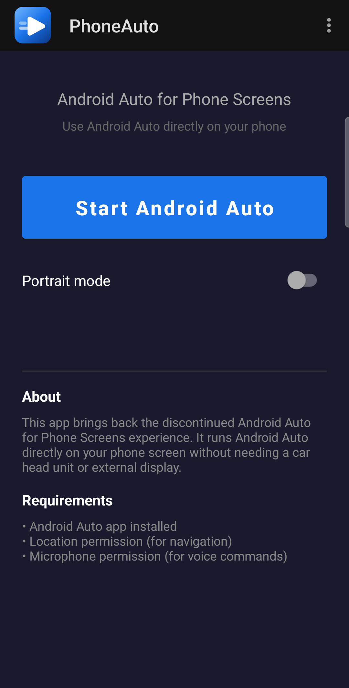

### Start a session

1. Open **PhoneAuto**.
2. Turn on **Portrait mode** if you want it (see below).
3. Tap **Start Android Auto**.
4. The first time, allow **location** (for navigation), **microphone** (for voice commands) and **nearby devices** (for calls).

If Android Auto's head unit server isn't running yet, PhoneAuto shows **Start the head unit server** with the steps. Tap **Open Android Auto settings**, then tap **⋮** (top right) › **Start head unit server**, and come back. The screen closes by itself once Android Auto connects.

You need to start the head unit server again after the phone restarts or Android Auto updates. To skip that, turn on [one-tap start](#one-tap-start-optional).

### Portrait or landscape

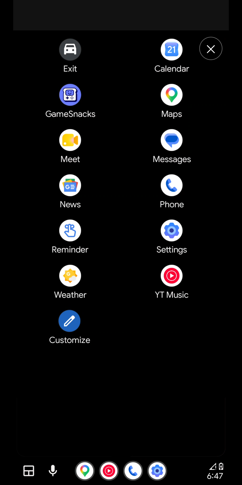

- **Portrait mode on:** Android Auto uses its own tall layout, with the app bar at the bottom. Good for a vertical phone mount.
- **Portrait mode off:** the classic landscape car layout, with the app bar on the left.

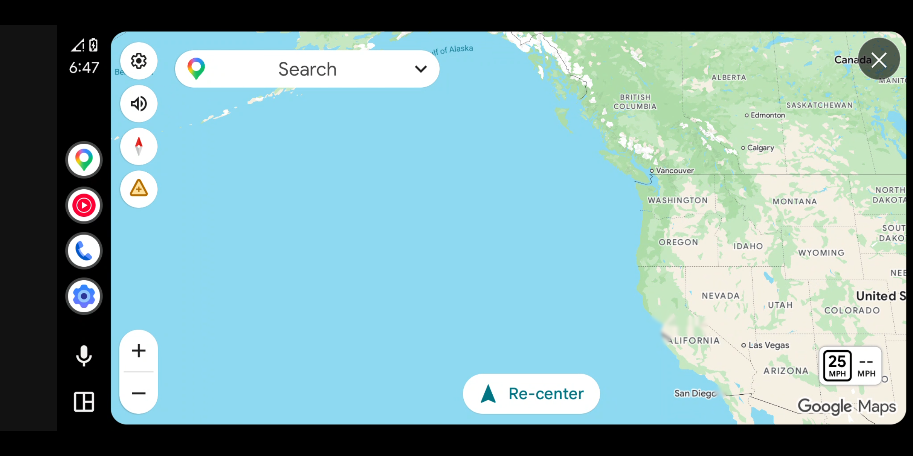

On a foldable's inner screen, **Portrait mode on** fills the screen in portrait.

The choice applies when a session starts. To switch, [end the session](#end-a-session), change the switch, and start again.

### Icon and text size

In portrait, Android Auto's UI is a little smaller than in a car, because Google Maps only opens its search panel when Android Auto's screen is wide enough. For bigger icons and text, turn on **Larger icons and text** before you start. In portrait, Maps search may not open with it on.

### During a session

PhoneAuto shows exactly what a car would: tap apps in the bar or the app grid, use **Maps**, **Waze**, music apps, **Phone** and **Messages**, and tap the microphone for Google Assistant or Gemini.

- The screen stays on during a session.
- To go back to your phone, press Home. Android Auto keeps running; open PhoneAuto and tap **Return to car** to go back.
- Some apps (such as Weather) answer through the Assistant, which dims the screen for a moment while it replies.

### End a session

Touch the screen to show **✕** in the top corner, then tap it. You're back on PhoneAuto's start screen. (✕ hides itself after a few seconds so it doesn't cover Android Auto.)

## One-tap start (optional)

The APK versions can start Android Auto's head unit server for you, so after a restart you just tap **Start Android Auto**. It uses an accessibility service that only acts when you start a session, and only taps **Start head unit server** in Android Auto's settings. It doesn't read anything else.

1. Do the [one-time developer mode setup](#one-time-setup-android-auto-developer-mode) first.
2. **Android 13 and later, if you installed the APK from a browser or file manager:** open **Settings › Apps › PhoneAuto** (or CarCast Launcher, or TarPlay), tap **⋮** (top right) › **Allow restricted settings**, and confirm. If you don't see that option, skip this step.
3. Open **Settings › Accessibility** (on Samsung: **Settings › Accessibility › Installed apps**), tap **PhoneAuto** (or **TarPlay**), and turn it on.

When you tap **Start Android Auto**, PhoneAuto briefly opens Android Auto's settings, taps **Start head unit server**, and comes back. If the server ever gets stuck, PhoneAuto restarts it the same way.

The Google Play versions don't include one-tap start; you start the head unit server by hand.

## CarCast Launcher

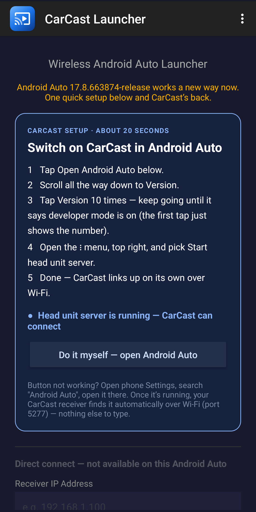

1. Put the phone and your CarCast receiver on the **same Wi-Fi**. The phone's hotspot works too: connect the receiver to it.
2. Open **CarCast Launcher**. It shows whether the head unit server is running. If it isn't, follow the steps on screen: **Do it myself — open Android Auto**, then **⋮** › **Start head unit server**.
3. Leave the app. A notification shows CarCast Launcher is running; the receiver finds the phone over Wi-Fi and Android Auto appears on its screen. There's no IP address to type.
4. To stop, tap **Stop** in the notification.

**With iCarCast on an iPad or iPhone:** in iCarCast, turn on Android Auto under **Settings › Modes**, then tap the **Android Auto** button. See [Android Auto in the iCarCast user guide](https://github.com/rPlayAI/carcast-public/blob/main/docs/icarcast-user-guide.md#android-auto).

**Direct connect** (enter the receiver's IP address) only works with older Android Auto versions; on current ones the app shows it as not available.

## TarPlay Tesla

TarPlay streams your phone's Android Auto to your Tesla's browser over the phone's hotspot. The phone serves the page itself, at a secure address (https) that only works while the car is on the phone's hotspot.

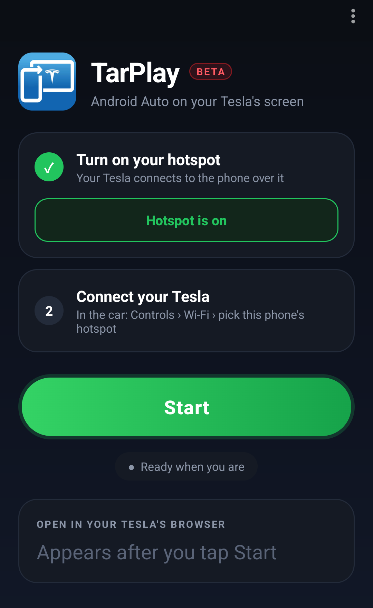

### Start

1. Do the [one-time developer mode setup](#one-time-setup-android-auto-developer-mode). [One-tap start](#one-tap-start-optional) works in TarPlay too.
2. Open TarPlay and tap **Turn on hotspot** (it opens the phone's hotspot settings). The first card turns green when the hotspot is on.
3. In the car: **Controls › Wi-Fi**, and pick your phone's hotspot.
4. Tap **Start** on the phone. The first time, Android asks to allow a VPN connection: tap **OK**. TarPlay uses it only so the car can find the phone at v.tarplay.com; none of your traffic goes through it. TarPlay then shows the address to open, **https://v.tarplay.com:8081** (tap it to copy).
5. Open the Tesla browser and go to that address. Android Auto appears after a second or two. Touch works on the car screen.

Tap **Stop** to end. Settings (driver side, resolution, frame rate) are under **⋮**.

If the phone is also on Wi-Fi, TarPlay shows a second, local address. That one is handy for trying it out from a laptop on the same Wi-Fi, but it isn't secure (https) on that address, so use the v.tarplay.com address in the car.

### Only one screen at a time

If you open the page on a second screen, the newest one takes over and the older one says *Android Auto is showing on another screen*. Reload the page on the screen you want.

### TarPlay Receiver

TarPlay Receiver runs on an Android tablet or head unit and shows a phone's Android Auto there, like the screen in a car. There are three ways to connect a phone.

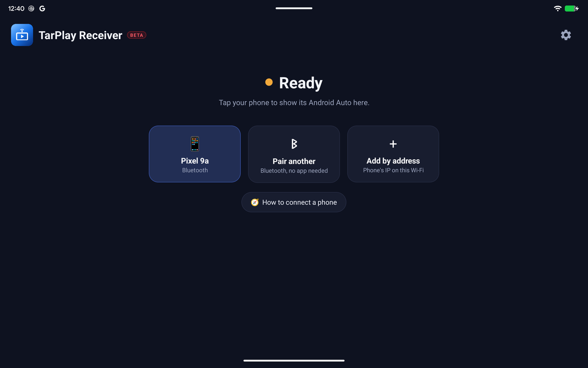

Tap **How to connect a phone** on the start screen for a short version of the steps below.

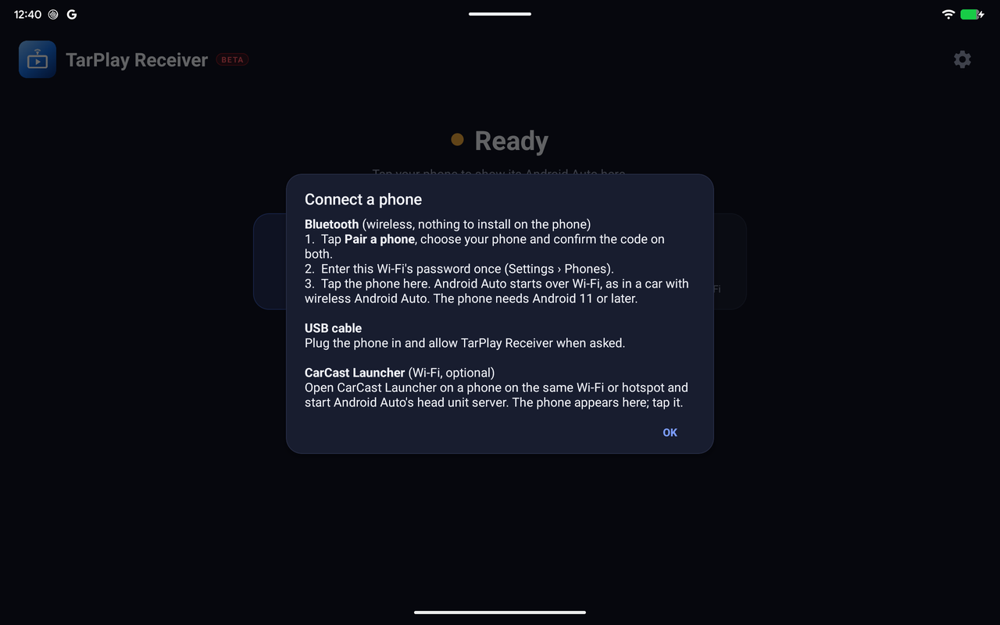

### Bluetooth (wireless, nothing to install on the phone)

1. On the receiver, tap **Pair a phone**. Open Bluetooth settings on the phone so it can be found, pick it in the list, and confirm that the code matches on both. Pair from the receiver, not from the phone's settings.
   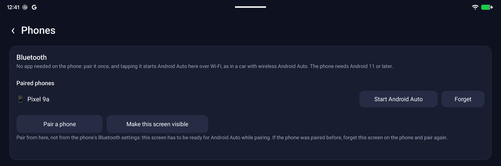

2. Open **Settings › Phones** on the receiver and enter the Wi-Fi password once. The Wi-Fi name fills in by itself: it's the network the receiver is on.
3. Tap the phone on the start screen. The phone joins that Wi-Fi and Android Auto appears, as in a car with wireless Android Auto. Next time it connects again by itself.

The phone needs Android 11 or later, and the Wi-Fi must be **5 GHz**: on 2.4 GHz wireless Android Auto starts but drops after a few seconds.

**Which Wi-Fi.** Any 5 GHz network both can reach: home Wi-Fi, another phone's hotspot, or the receiver's own hotspot.

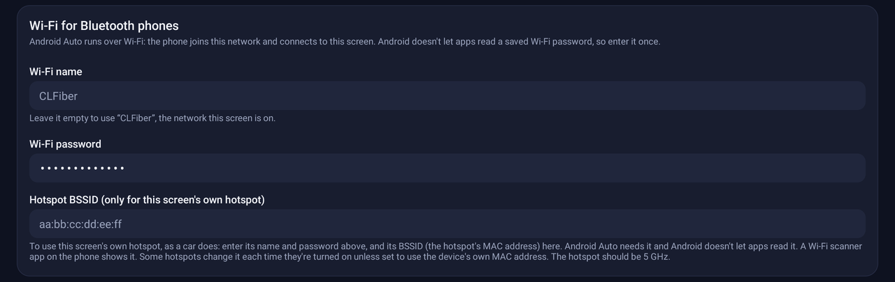

**The receiver's own hotspot**, as in a car (the head unit is the Wi-Fi):

1. Turn on the hotspot on the head unit or tablet and set it to **5 GHz**.
2. In **Settings › Phones**, enter the hotspot's **name** and **password**, and its **BSSID**. Android Auto needs the BSSID, and Android doesn't let apps read it.
3. To find the BSSID, look at the hotspot from another Android phone: a Wi-Fi scanner app (such as WiFiAnalyzer) lists each network with its BSSID. On a Pixel you can also turn on Developer options › **Wi-Fi verbose logging** and open the network in Wi-Fi settings. Use the 5 GHz entry if the hotspot shows two. (An iPhone's "Wi-Fi Address" is the iPhone's own address, not the BSSID.)
4. Some hotspots pick a new BSSID each time they're turned on. If yours does, set its MAC address to the device's own (if the hotspot settings offer it), or update the BSSID when it changes.

### USB cable

Plug the phone into the receiver with a data cable and allow TarPlay Receiver when asked. Android Auto starts on the receiver.

### CarCast Launcher on the phone

Phones running [CarCast Launcher](#carcast-launcher) on the same Wi-Fi appear on the start screen by themselves; tap one to connect. You can also tap **Add by address** and type the phone's IP. This needs Android Auto's head unit server on the phone, like the other apps.

### During a session

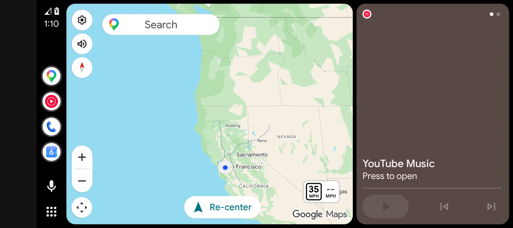

Use Android Auto's **Exit** (in the app grid) to go back to the start screen; Android Auto keeps running and **Back to Android Auto** returns to it. **Disconnect** ends the session. To use a different phone, tap it on the start screen.

### Display

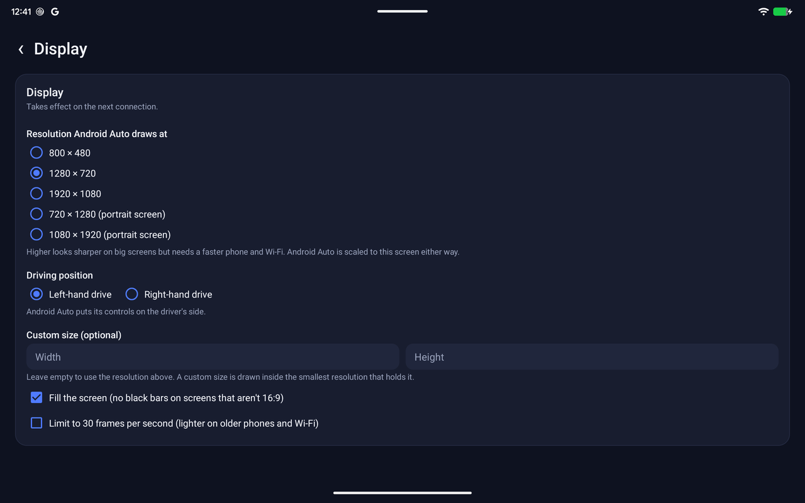

**Settings › Display** sets the resolution Android Auto draws at, the driving side, and **Fill the screen** (on by default: no black bars on screens that aren't 16:9). A **custom size** draws Android Auto at exactly that size; leave it empty for the normal full screen.

### Receiver troubleshooting

**"Couldn't find the network… 5 GHz".** The phone couldn't find the Wi-Fi name the receiver handed it, or the network is 2.4 GHz only. Check the name in Settings › Phones (hotspot names are easy to mistype) and use a 5 GHz network. With the receiver's own hotspot, also check the BSSID: it may have changed when the hotspot was turned on again.

**"Enter its BSSID".** The Wi-Fi name in Settings › Phones is the receiver's own hotspot. Enter its BSSID (see [Bluetooth](#bluetooth-wireless-nothing-to-install-on-the-phone)), or clear the name to use the network the receiver is on.

**"Couldn't join… Check the Wi-Fi password".** Re-enter the password in Settings › Phones.

**"Couldn't reach" the phone, or it stays on "Waiting for Android Auto".** The receiver reconnects Bluetooth by itself a few times. If it still doesn't start, turn the phone's Bluetooth off and on. If the phone no longer lists the receiver (it was paired with another screen since), **Forget** it in Settings › Phones and pair again. A phone can start wireless Android Auto with only one screen at a time; turn off other receivers it's paired with.

**Android Auto drops after a few seconds.** The Wi-Fi link is too weak or on 2.4 GHz. Move closer or use a 5 GHz network.

**Small window instead of full screen.** Clear the custom size in Settings › Display.

**Maps search or music says "Offline".** During wireless Android Auto the phone reaches the internet over its **mobile data**: the Wi-Fi it joins is a link to the screen, as in a car. A phone without mobile data (no SIM) can't search or stream in a session; maps it already has still show.

## Troubleshooting

**The page doesn't load.** Check that the car (or the device you're testing with) is on the phone's hotspot, not on another Wi-Fi, and that you tapped **Start**. On an iPhone or Mac used for testing, turn off **iCloud Private Relay** and **Limit IP Address Tracking** for the hotspot network; they bypass the hotspot's address lookup.

**The browser says "Not Secure".** If you ever clicked through a certificate warning for this address, the browser remembers it. Quit the browser completely and reopen it (in Safari you can also clear the website data for tarplay.com).

**The page stays black.** Reload it once. If it still stays black, tap **Stop** and **Start** in TarPlay, and reload.

## Troubleshooting

**"Start head unit server" isn't in the ⋮ menu.**
Developer mode isn't on yet. Tap **Version** in Android Auto settings until it says developer mode is enabled.

**It's stuck on "Waiting for Android Auto" or "connecting".**
In Android Auto settings, tap **⋮** › **Stop head unit server**, then **⋮** › **Start head unit server**, and open PhoneAuto again. With one-tap start on, PhoneAuto does this by itself.

**Maps says "There was an issue loading maps", or Maps is missing from the app list.**
Google Maps needs location permission: **Settings › Apps › Maps › Permissions › Location › Allow only while using the app**. Then end the session and start a new one.

**PhoneAuto says "Permissions required".**
Tap **Start Android Auto** again and allow the permissions, or open **Settings › Apps › PhoneAuto › Permissions** and allow location, microphone and nearby devices.

**Start says Android Auto isn't installed.**
PhoneAuto runs Android Auto on the same phone, so install Android Auto from Google Play first. To show a phone's Android Auto on a tablet or another screen, use CarCast Launcher with a CarCast receiver instead.

**Tapping Search in Maps does nothing (portrait).**
Turn off **Larger icons and text**, end the session with **✕** and start again.

**Portrait mode shows the landscape layout.**
End the session with **✕**, make sure **Portrait mode** is on, and start again. The choice only applies when a session starts.

**The ⋮ menu or one-tap start doesn't work on my phone.**
Some phones word the menu differently. Start the head unit server by hand and [tell us](#reporting-a-problem) your phone model and language.

**Can't find Android Auto settings.**
Open your phone's Settings app, search for "Android Auto", and open the result.

## Updates and expiry

- The APKs here are **beta builds** and stop working on the date in the file name (for example `PhoneAuto-beta-2027-02-03.apk` or `TarPlay-Receiver-beta-2027-02-03.apk`). Install a newer one from [Releases](https://github.com/rPlayAI/tarplay-public/releases) before then; it installs over the old one and keeps your settings.
- The Google Play versions don't expire and update through Play.
- APK and Google Play versions are signed differently, so one can't update the other. To switch, uninstall the one you have first.

## Privacy

Nothing leaves your phone. PhoneAuto talks to Android Auto on the same phone (127.0.0.1); CarCast Launcher only talks to devices on your own Wi-Fi. TarPlay Tesla only sends the Android Auto picture to the browser on the phone's own hotspot; the only thing it fetches from the internet is the security certificate for v.tarplay.com. There are no accounts, ads, analytics or tracking. Privacy policies: [PhoneAuto](https://download.youcast.cn/phoneauto-privacy.html) · [CarCast Launcher](https://download.youcast.cn/carcast-privacy.html).

## Reporting a problem

[Open an issue](https://github.com/rPlayAI/tarplay-public/issues/new/choose) with:

- the app and version (PhoneAuto › ⋮ › About);
- your phone model and Android version;
- your Android Auto version (Android Auto settings › Version);
- what you did, what you expected, and what happened. Screenshots help.

---

PhoneAuto, CarCast Launcher and TarPlay are independent apps and are not affiliated with or endorsed by Google or Tesla. Android Auto is a trademark of Google LLC. Tesla is a trademark of Tesla, Inc.
